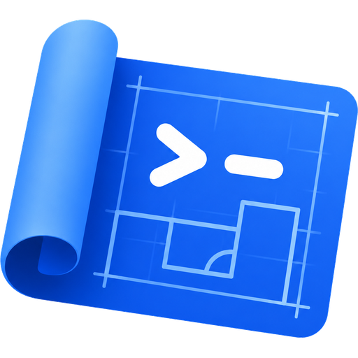
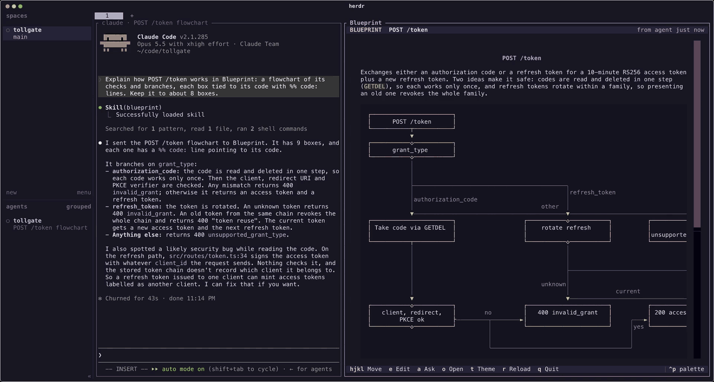
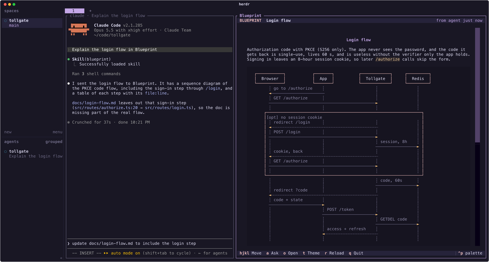
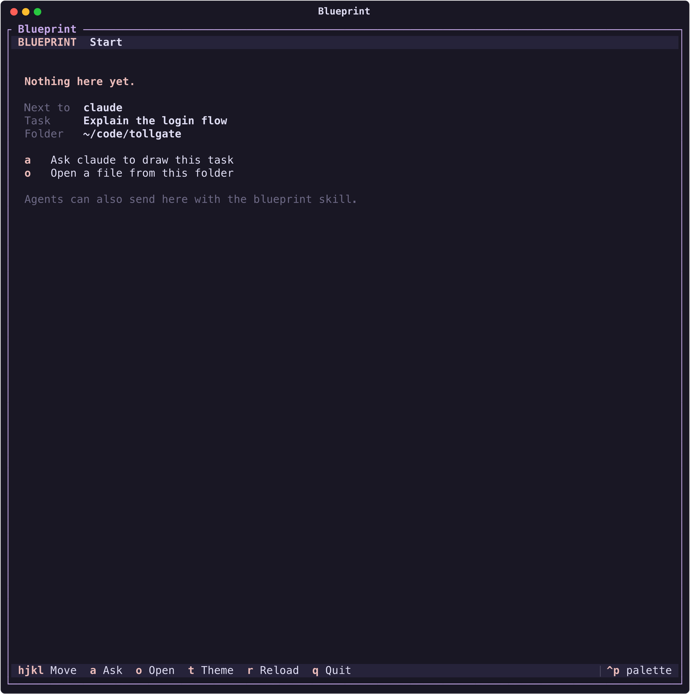
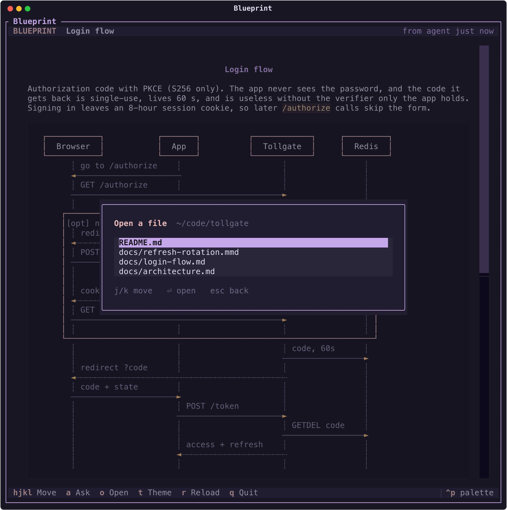
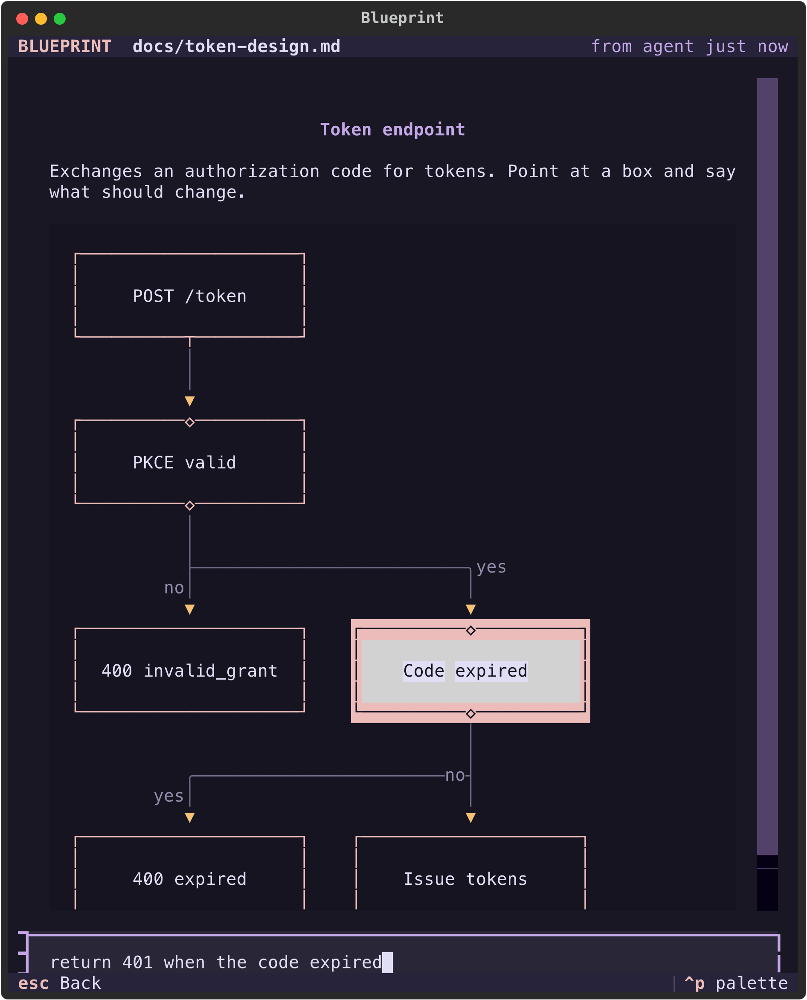
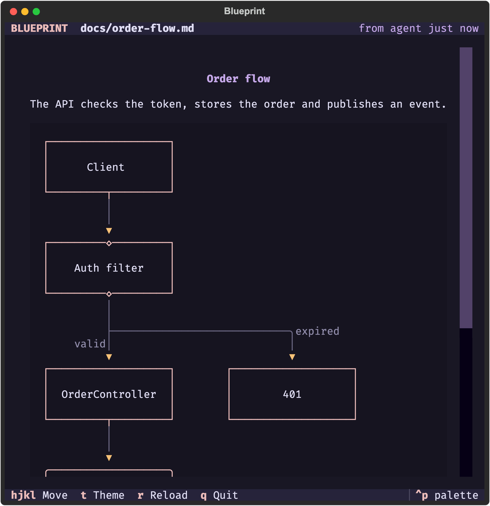
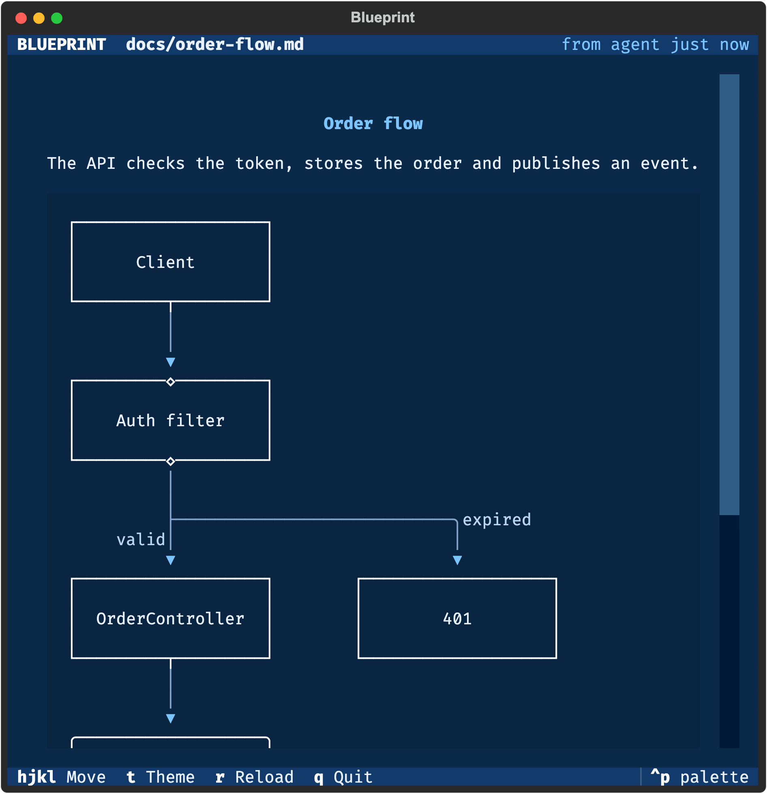
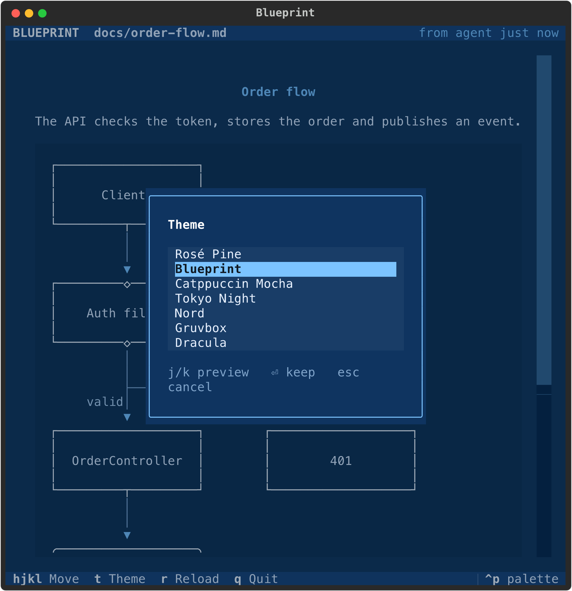

<p align="center">
  
</p>

<h1 align="center">Blueprint</h1>

<p align="center"><b>Your coding agent explains its work as diagrams, right next to the chat.</b></p>

<p align="center">Live Markdown and Mermaid for your agent's side pane, in your terminal.</p>

<p align="center">
  
  
  
  
</p>

<p align="center">
  
  <br>
  <sub>Point at a box and ask for a change. The agent changes the code behind it, and Blueprint draws the new version. (<a href="docs/screenshots/herdr-demo.mp4">MP4</a>)</sub>
</p>

## Why

Coding agents explain their work in long chat messages. To see what is being
built, you read a wall of text. To change one part, you first describe where it
is.

Blueprint fixes both ends.

- **See it at a glance.** The agent draws what it is building, its flow and its
  branches, next to the chat, and keeps the drawing current as it works.
- **Ask where you look.** Point at a box and write "add rate limiting here". The
  agent gets that part, the code behind it, and your note.

## What it is

Blueprint is a [herdr](https://herdr.dev) plugin. Put it next to your coding
agent and it shows one thing: the latest doc or diagram the agent sent, drawn
in your terminal with colors that match your theme.

- **One screen.** Each send replaces what is shown. Nothing piles up.
- **Point and ask.** Press `e`, pick a box, a branch or a block, and say what
  should change: the agent next to Blueprint gets the part, its place in the
  source and your note.
- **Work orders on code.** When the agent ties boxes to its code, your note
  becomes a change to that code: made, tested, and drawn again.
- **Kept current.** With the skill, the agent redraws the code it is building
  after each unit of work, while Blueprint is open, and the header says when
  the code behind a drawing changed since it was drawn.
- **Draw on request.** Mermaid is drawn with [termaid](https://github.com/fasouto/termaid)
  when the sender adds `--draw`; otherwise it stays as clean text. The agent
  (or `r`) redraws what is on screen.
- **Knows its neighbor.** Opened next to an agent, it asks the agent to draw
  what it is doing (once it is free). Press `a` to ask again, or `o` to open a
  doc from the agent's folder.
- **Themes.** Press `t` to pick a theme. Only your theme is saved.
- **Runs everywhere.** macOS, Linux and Windows. No browser, no images.

<p align="center">
  
</p>

## Next to your agent

Opened next to an agent, Blueprint shows who is there and asks the agent to
draw what it is doing, even while it works (agents queue what arrives); one
waiting for your answer is asked after. Press `a` to ask
again, or `o` to open a doc from its folder.

<p align="center">
  
  
</p>

## Install

You need [uv](https://docs.astral.sh/uv/) and herdr 0.9.3 or newer.

```bash
herdr plugin install chappse6/herdr-blueprint
herdr plugin action invoke seeun.blueprint.open
```

It opens to the right of the focused pane and takes the focus. If Blueprint is
already open in the workspace, it is focused instead of opening a second one.
Bind it to a key in `~/.config/herdr/config.toml`:

```toml
[[keys.command]]
key = "prefix+alt+b"
type = "plugin_action"
command = "seeun.blueprint.open"
description = "open Blueprint"
```

## Keys

| Key | Action |
|---|---|
| `h` `j` `k` `l` | Move left, down, up, right |
| `g` `G` | Top, bottom (pointing: first, last part) |
| `ctrl+d` `ctrl+u` | Half a page down, up (pointing: the selection moves) |
| `e` | Point at a part (pointing: edit the text at it) |
| `Enter` | Pointing: write a note about the part and send it |
| `c` | Pointing at a part tied to code: open that code in your editor |
| `Esc` | Pointing: close the note, then stop pointing |
| `a` | Ask the agent next to Blueprint to draw its task |
| `o` | Open a Markdown or Mermaid file from that pane's folder |
| `t` | Change theme |
| `r` | Reload |
| `q` | Quit |

## Point and ask

Press `e` and the first part of what Blueprint shows is selected: a box or a
branch (a labelled arrow, or an arm of a choice) in a flowchart or state
diagram, a participant or message in a sequence diagram, a heading, paragraph,
list or table in a document. A diagram drawn inside a document is pointed at
box by box too: `j` and `k` walk the document and step into it, `h` `j` `k` `l`
move between its boxes, and going past its top or bottom leaves it. Click a
part to select it. Moving follows the screen: `h` and `l` reach what is on the
same rows, `j` and `k` what is in the same columns (else the next row), and an
arrow leads to what it joins. Press Enter, say what should change, and press
Enter again: the agent next to Blueprint gets the part, where it is in the
source and your note. Esc steps back. While you type a note, whatever the agent sends waits
until you close it, and a note you keep moves to the next version of the same
diagram.

<p align="center">
  
</p>

When the agent draws the code it is building, it ties each box to that code
with a comment Blueprint doesn't draw:

```
flowchart TD
  T[POST /token] --> V{PKCE valid}
  V -->|no| E[400 invalid_grant]
  V -->|yes| I[Issue tokens]
  %% Blueprint: the code each box stands for (not drawn)
  %% code: V src/auth/pkce.ts:10
```

Point at such a box (or one of its branches), write "return 401 when the code
expired", and the request is a work order: the agent changes the code at
`src/auth/pkce.ts:10`, runs the tests, and redraws the design. To read that code
yourself, press `c`: it opens in your editor at that line.

To change the text yourself, press `e` again while pointing. Your editor
(`$BLUEPRINT_EDITOR`, `$VISUAL`, `$EDITOR`, else vim, vi or nano) opens on that
line, in a pane below Blueprint inside herdr, and every save redraws the drawing
above. Save and quit (`:wq`) and the change goes to the agent: a diff for a
file, the new version for something the agent sent. Quit without saving (`:q!`)
and nothing happens. Blueprint never writes the file itself: the agent applies
the change, and you roll it back the way you roll back any agent change. Set
`BLUEPRINT_EDITOR` when your `$EDITOR` is set up for something else, such as an
editor that starts in insert mode.

With no agent there but a shell, Blueprint offers to start one. A note that
could not be sent is kept for that part; an edit, for that document. Point
again (or press `e` twice) to pick it up, or save an edit empty to throw it
away.

## Send things from an agent

```bash
herdr-blueprint show docs/design.md               # a file
printf 'graph LR\n  A --> B\n' | herdr-blueprint send --draw --title "Flow"
herdr-blueprint refresh --draw                    # redraw what is shown
herdr-blueprint status                            # open or closed
```

`--draw` makes Blueprint draw Mermaid. Without it, diagrams show as text, which
is faster. Each send or refresh carries its own flag.

`herdr-blueprint` is on your `PATH` once the skill is installed (see below; it
goes in `~/.local/bin`). Without it, run the command through the plugin folder:

```bash
root=$(herdr plugin list --plugin seeun.blueprint --json | uv run --no-project --quiet python -c 'import json, sys; p = json.load(sys.stdin)["result"]["plugins"]; print(p[0]["plugin_root"] if p else "")')
uv run --project "$root" --no-sync python -m herdr_blueprint send --draw --title "Flow" < flow.mmd
```

Teach Claude Code and Codex to use Blueprint on their own: draw what they are
building, keep it current, and act on what you point at or edit:

    herdr plugin action invoke seeun.blueprint.install-skill

This links `skills/blueprint` into `~/.claude/skills` and `~/.agents/skills`
(a copy on Windows when symlinks are not allowed) and puts the short
`herdr-blueprint` command in `~/.local/bin`. Start a new agent session to pick
it up. Undo with `herdr-blueprint uninstall-skill`.

## Token use

Blueprint itself uses no tokens; the agent does when it writes what Blueprint
shows. The skill asks the agent to redraw its design after each unit of work
(a feature piece, a fix, a change to the flow), but only while Blueprint is
open: it first runs `status`, a short command, and draws nothing when Blueprint
is closed. Agents load a skill when its description matches what they are
doing; if yours doesn't redraw, press `a`.

Rough figures, not measurements (they vary with the model, the language and the
size of the diagram):

| What | Tokens |
|---|---|
| One redraw: a summary, a diagram of 10 to 20 boxes, its `%% code:` lines | about 0.5k to 1.5k written; text in languages other than English takes more |
| The check when Blueprint is closed | about 100 written, plus one more step |
| Loading the skill, once per session | about 2k read |
| An hour with ten units of work | about 5k to 15k written |

Each redraw is also one more step for the agent, which reads its conversation
again; prompt caching makes that cheap, but it counts toward usage limits. To
use fewer tokens, close Blueprint while you don't look at it, or tell the agent
to redraw only when you press `a`.

## FAQ

**Why not just ask the agent for Mermaid?** You can, and Blueprint draws it. What
it adds: the drawing stays current (redrawn after each piece of work, flagged
when the code behind it changed), you point at a part instead of describing
it, boxes tied to code turn your note into a change to that code, and it all
runs locally in your terminal, as open source.

**Does it cost tokens?** Blueprint doesn't; the agent does when it draws. See
[Token use](#token-use).

## Themes

Rosé Pine (default), Blueprint, Catppuccin Mocha, Tokyo Night, Nord, Gruvbox
and Dracula. Your choice is saved.

<p align="center">
  
  
</p>



## Development

```bash
uv sync
uv run pytest
uv run herdr-blueprint            # run outside herdr
herdr plugin link "$PWD"          # use this folder as the plugin
```

README images come from `scripts/screenshots.py` (themes) and
[`scripts/demo`](scripts/demo/README.md) (herdr with an agent).

## Credits

Blueprint stands on these MIT-licensed projects:

- [termaid](https://github.com/fasouto/termaid) by Fabio Souto: Mermaid in the terminal
- [Textual](https://github.com/Textualize/textual) and [Rich](https://github.com/Textualize/rich) by Will McGugan and Textualize
- [watchfiles](https://github.com/samuelcolvin/watchfiles) by Samuel Colvin
- [platformdirs](https://github.com/tox-dev/platformdirs)

## License

MIT
