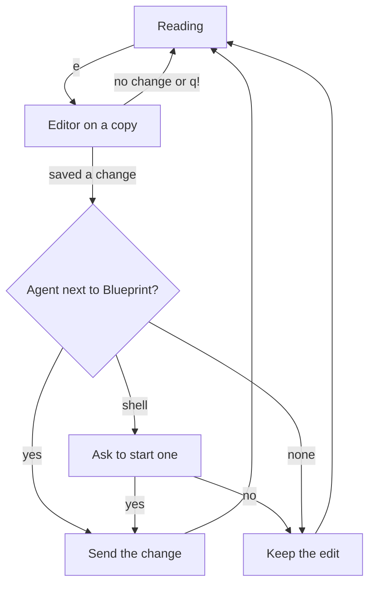

# Blueprint edit mode: design

Date: 2026-10-10. Status: decided.

## Goal

Let the person correct what Blueprint shows, a doc or a diagram, in their own
editor and hand that change to the agent next to Blueprint.

## Decision

One key, `e`. The editor's own exit is the choice:

- **Save and quit** (`:wq`): the change goes to the agent.
- **Quit without saving** (`:q!`), or no change, or the editor exits with an
  error (`:cq`): nothing happens.

This is how `git commit`, `git rebase -i`, `kubectl edit` and `crontab -e`
work, so there is nothing new to learn. An earlier draft of this design had a
draft state after the editor with six keys (send, write, discard, diff, undo,
edit again). Its review showed that most defects lived in that state (results
landing on the wrong draft, writing after sending, sends held until discard,
undo states), so the state is gone.

## Rules

1. Reading stays as it is. `e` is the only new key.
2. The editor opens a copy. Blueprint never writes the file being shown: the
   agent is the only one writing, so nothing needs undoing on Blueprint's side
   and the two never collide. The agent's own changes can be rolled back with
   the agent (Claude Code's `/rewind`) or git.
3. Blueprint never starts an agent without asking.
4. An edit that could not be sent is not lost: it stays in memory, and the next
   `e` opens it again.
5. Nothing new outlives the session. The copy is deleted as soon as the editor
   closes. A long diff given to the agent as a file is deleted when Blueprint
   closes.

## Flow



## The editor

- Command: `$VISUAL`, then `$EDITOR`, then the first of `vim`, `vi`, `nano` on
  PATH; on Windows `notepad` last. `code` and `subl` get `--wait`. Quotes around
  a program path are removed and the program is resolved on PATH, so
  `"C:\Program Files\Notepad++\notepad++.exe" -multiInst` and `EDITOR=code` work
  on Windows.
- Run inside Blueprint's pane with Textual's `App.suspend()` (Unix and Windows).
  Ctrl+C is ignored by Blueprint while the editor runs, as git does, so it
  reaches the editor instead of killing Blueprint.
- The copy lives in a fresh temporary folder and is named after the original
  (`login-flow.md`), cleaned to letters, digits, `.`, `_` and `-`, at most 60
  characters, ending in `.mmd` for diagrams and `.md` otherwise. A title from an
  agent can therefore never make an invalid file name.
- No editor, or suspend not supported: a warning, nothing else happens.

## What can be edited

| On screen | The copy starts from |
|---|---|
| A file (`show`, or picked with `o`) | the file on disk, read at `e` |
| Text or Mermaid an agent sent | the sent source |
| An edit that was not sent | that edit (its original stays the base) |
| A file cut by the 1 MB limit, the welcome or start screen | not editable; `e` is hidden |

## Sending

1. Look at the pane next to Blueprint again, as `a` does.
2. **Agent there**: send with `herdr agent prompt`. The header says
   "Sending to claude…" and then "Sent your edit to claude". `e` is unavailable
   until the send finishes, so two edits never overlap.
3. **A shell at its prompt** (its only foreground process is the shell itself):
   ask "Start an agent next to Blueprint and send your edit?". With one agent
   kind on PATH this is yes/no; with several, a list (claude first). Yes runs
   `herdr agent start bp-<kind>-<pane> --kind <kind> --pane <id>` (the pane id
   cleaned to a valid name), then sends.
4. **No neighbor, or it runs something else**, or the person says no, or the
   send fails: the header says why and "press e to edit it again". The edit is
   kept (rule 4).

### The prompt

For a file, the path is relative to the agent's folder when the file is inside
it, otherwise absolute:

````text
I edited docs/login-flow.md in Blueprint. Apply this change to the file and
to anything that depends on it, then show the result in Blueprint.
```diff
<unified diff against the file as it was when I opened it>
```
````

If the file on disk changed while the editor was open, a line says so and asks
the agent to read the file before applying the diff.

For text an agent sent, there is no file, so the prompt gives the new version:
"I edited the diagram you sent ('Login flow') in Blueprint. This is what I want
instead; update what it describes, then send the new version to Blueprint",
followed by the new source in a `mermaid` or `markdown` fence.

The diff or source sits in a fence, so the agent's screen does not turn `+`
lines into list bullets. Text longer than 6,000 characters goes into a file in
Blueprint's own temporary folder instead, and the prompt names its path.

## Sends that arrive while the editor is open

Blueprint is suspended while the editor runs, so it reads nothing. Sends that
arrived meanwhile are handled when the editor closes, as usual: the newest one
replaces the screen.

## Safety

- Titles and file text shown in the header or notices go through `clean()`, so
  control characters never reach the terminal.
- Every failure (temporary folder, editor, herdr) ends as a header warning.
  Nothing in the edit path can close Blueprint.
- Ctrl+C and Ctrl+Q keep their usual meaning.

## Parts

- `edit.py`: `editor_command()`, `copy_name()`, `unified_diff()`,
  `prompt_for()`, `kinds_on_path()`. No Textual.
- `sources/pane.py`: `send_prompt()` shared with `a`, `shell_is_idle()`,
  `start_agent()`.
- `app.py`: `action_edit`, the send worker, the start dialog, the kept edit.

## Testing

- `edit.py`: editor resolution (env order, PATH, quotes, Windows, `--wait`),
  copy names from hostile titles, diff, prompts for files (relative path,
  changed-on-disk line, fenced diff) and for sent text, the 6,000-character
  switch to a file.
- App, with a fake editor: `e` hidden where it should be, no change, `:q!`,
  `:cq`, a saved change sent with the right prompt and the file untouched, the
  copy deleted afterwards, a failed send kept and reopened by `e`, `e`
  unavailable while sending, the start dialog (yes, no, several kinds), no
  neighbor, the long-diff file removed when Blueprint closes, a hostile title.
- Live, in the isolated demo herdr: nvim `:wq` and `:q!`, then a real Claude
  Code applying the change.
