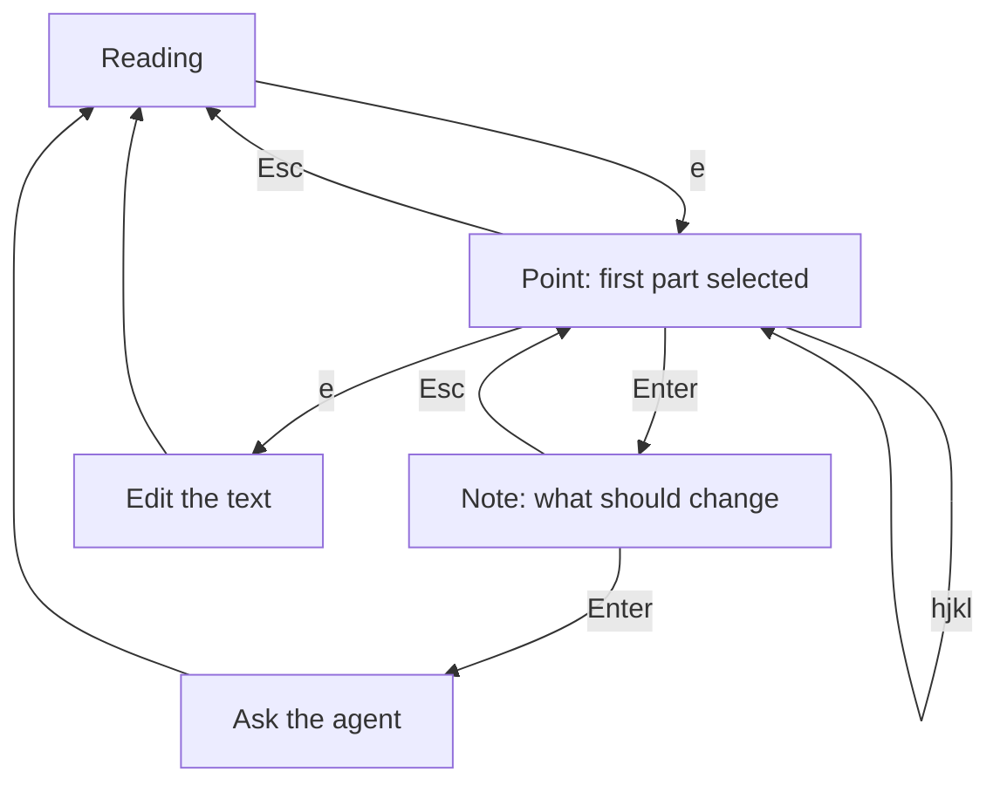

# Blueprint point and ask: design

Date: 2026-10-10. Status: draft for review.

This extends the edit design (`2026-10-10-blueprint-edit-design.md`). `e` now
starts by pointing at a part of the screen; editing the text becomes the second
step. Everything the edit design says about sending to the agent, starting an
agent and keeping unsent work still holds.

## Goal

Point at a part of what Blueprint shows (a box in a diagram, a message in a
sequence, a paragraph or a table in a doc), say what should change, and let the
agent change it. This is what clicking a part of a page does in a web canvas
editor, done in the terminal.

## Flow



- `e` selects the first part. The footer then shows only what works there:
  `hjkl Move  ⏎ Ask  e Edit text  esc Done`. No new key outside this mode.
- `h` `j` `k` `l` move to the nearest part in that direction. In a document,
  `j` and `k` go to the next and previous block.
- A mouse click selects the part under it, when the terminal passes clicks on.
- Enter opens a one-line note, "What should change here?". Enter sends it, Esc
  goes back to pointing.
- `e` again opens the text in the editor, on the selected part's line when the
  editor takes `+N` (vim, nvim, nano, helix, kakoune, micro, emacs).
- Esc leaves point mode.

## What can be pointed at

| On screen | Parts |
|---|---|
| A flowchart (`graph`, `flowchart`) or `stateDiagram`, drawn on its own | each node |
| A `sequenceDiagram` drawn on its own | each participant, each message |
| Any other diagram, a diagram shown as text, a diagram inside a document | the whole diagram |
| A Markdown document | each top-level block: heading, paragraph, list, table, quote, code or diagram block |
| The welcome or start screen, a large file in plain view | nothing; `e` stays hidden |

The selected part is shown in reverse video: the node's box, the participant's
box, the message's label and arrow rows, or the document block's background.
Moving the selection scrolls it into view, sideways too.

### Where the parts come from

- Nodes: termaid's `compute_layout` gives every node's box in canvas cells.
  Checked against real output: the boxes match the drawing to the cell,
  including with Korean labels.
- Sequences: termaid's sequence `_compute_layout` gives each participant's
  center and box width and each message's arrow row; the label is the row above.
  Checked against real output.
- Both are computed with the same padding Blueprint chose for the drawing (it
  tries a roomier layout first, then compact ones).
- Documents: Textual makes one widget per top-level block. The same Markdown
  parser gives each block's source line range, in the same order.

These are termaid internals. termaid is pinned, and a test draws sample
diagrams and checks that every part's box sits exactly on the drawn box
corners, so an upgrade that changes the layout fails loudly instead of
selecting the wrong thing.

### Finding a part in the source

- A node: the first line that defines its id (`T[Tollgate]`, `T((x))`,
  `state T`), else the first line using the id as a word.
- A participant: its `participant` or `actor` line, else its first message.
- A message: the n-th message line, in the order termaid read them.
- A document block: its line range.
- Not found: the request still names the part's id and label.

## The request

For a file, with its path relative to the agent's folder:

````text
In Blueprint I pointed at the box "Tollgate" (node T) in `docs/login-flow.md`,
line 13: `participant T as Tollgate`.
Make the code expire in 30 seconds here.
Change it and anything it describes, then show the result in Blueprint.
````

For something the agent sent, there is no file to read, so the request names
"the diagram you sent ('Login flow')" and includes its source in a fence. Long
sources go in a file, as in the edit design. Control characters are removed.

Parts are described plainly: the box "Tollgate", the participant "Redis", the
message "GET /authorize" from Browser to Tollgate, the heading "Login flow",
the table under "Steps", the whole diagram.

Sending works exactly as in the edit design: an agent next to Blueprint gets the
request; a shell there gets an offer to start one; otherwise the note is kept.
A kept note fills the note line again the next time Enter is pressed on that
document. The header says "Asking claude…", then
"Asked claude about the box "Tollgate"". Point mode is locked while asking.

## Editing the text (second step)

As in the edit design, with one change inside herdr: the editor opens in a pane
below Blueprint instead of borrowing Blueprint's pane, so the drawing stays in
sight, and Blueprint redraws it from the copy every time the editor saves.

- The pane is a plugin pane (`editor` entry point) running
  `herdr-blueprint edit-session`, which runs the editor on the copy and writes
  its exit code next to it. herdr closes the pane when the editor exits and
  focus returns to Blueprint. (Tried in herdr: `:w` updates the copy, `:wq`
  leaves exit code 0, the pane closes and focus comes back.)
- The outcome is decided as before when the exit code appears: not saved at all
  or exit code not 0, nothing happens; saved, the final text decides (no change,
  empty to throw a kept edit away, otherwise send).
- `e` while the editor pane is open focuses it.
- The pane closed by hand (no exit code, pane gone): saved changes are kept as
  an unsent edit, otherwise nothing.
- Sends that arrive while the editor is open wait. If the edit is sent, they are
  dropped: the agent answers the edit with a new send anyway. Otherwise the
  newest is shown when the editor closes.
- Outside herdr, or if the pane cannot open, the editor borrows Blueprint's pane
  as before (no live preview).

## Out of scope for now

Edges, nodes inside diagrams that sit in a document, part-level pointing in
other diagram types, selecting several parts at once.

## Parts

- `point.py` (new, no Textual): `Part` (kind, label, id, cell boxes, source
  lines), `diagram_parts()`, `document_parts()`, `nearest()`, `describe()`,
  `point_prompt()`.
- `diagram.py`: report which layout the drawing used, so parts match it.
- `app.py`: point mode (selection, highlight, contextual footer, note line,
  scrolling), sending through the edit design's path, the live editor pane.
- `herdr-plugin.toml`: the `editor` pane; `cli.py`: `edit-session`.

## Testing

- `point.py`: parts for flowchart, state and sequence diagrams sit on the drawn
  box corners (with CJK labels and in each layout Blueprint may pick); `nearest`
  in all four directions; source lines for nodes, participants, messages and
  document blocks; descriptions; prompts for files and sent text.
- App: `e` enters point mode only where there are parts; movement; the
  highlight follows; Enter, note, send with the right context; Esc at both
  levels; `e` twice opens the editor on the part's line; locked while asking; a
  kept note comes back.
- Editor pane: the outcome from the exit file, redraw on save, focus on a
  second `e`, the pane closed by hand, sends held during the edit.
- Live, in the isolated demo herdr: point at a node and a message, ask a real
  Claude Code, watch the drawing change; edit with nvim in the pane below and
  watch each `:w`.
